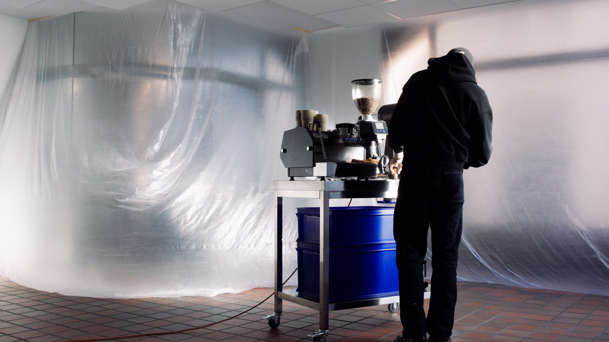
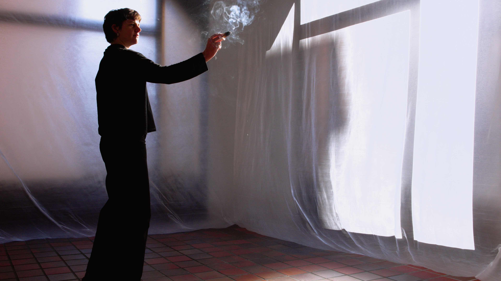

*Labor Laurenzentorgasse, November 2026. Fotografie: 021_BUERO. © 2026 021_BUERO.*

LABOR LAURENZENTORGASSE vereint Architekturbüro und Bäckerei:

021_BUERO ist ein Architekturbüro. Den Begriff verstehen wir offen. So bringen wir unterschiedliche Hintergründe und gelernte Disziplinen zusammen: Architektur, Hospitality und Food Science. Dieses Wissen tragen wir zusammen und entwickeln Projekte an den Schnittstellen unserer Kompetenzen. Letztlich beschäftigen wir uns mit der Gestaltung von Raum, sei es durch die konstruktive Ausführung physischer Räume oder die Konzeption sozialer Räume.

034_BAKERY ist eine handwerkliche Sauerteigbäckerei. Darin bieten wir Brot, Sandwiches über Mittag oder Süssgebäck und Kaffee für zwischendurch an. So möchten wir Teil des alltäglichen Lebens in der Aarauer Altstadt sein. Komm gerne vorbei; von Mittwoch bis Samstag ab 8 Uhr bis fertig.

*Labor Laurenzentorgasse, November 2026. Fotografie: 021_BUERO. © 2026 021_BUERO.*