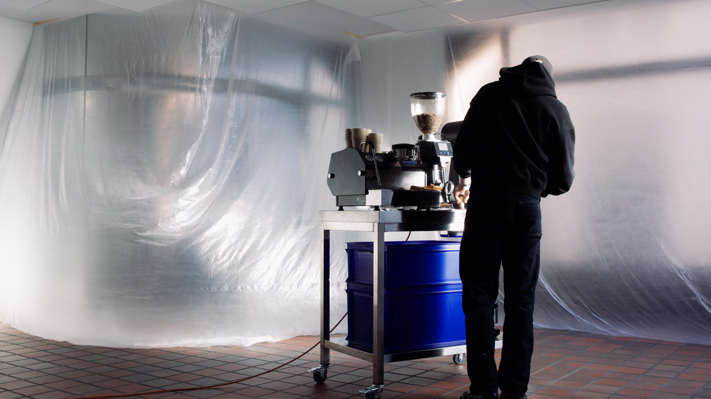
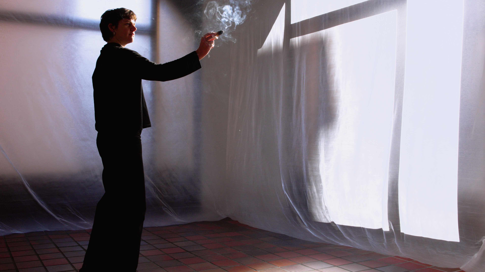

*Labor Laurenzentorgasse, November 2026. Photograph: 021_BUERO. © 2026 021_BUERO.*

LABOR LAURENZENTORGASSE combines an architecture office and a bakery:

021_BUERO is an architecture office. We understand the term broadly. We bring together different backgrounds and disciplines: architecture, hospitality, and food science. We combine this knowledge to develop projects at the intersections of our expertise. Ultimately, our work is concerned with the shaping of space, whether through the construction of physical spaces or the conception of social spaces.

034_BAKERY is an artisanal sourdough bakery. We offer bread, sandwiches for lunch, as well as pastries and coffee throughout the day. In this way, we hope to become part of everyday life in Aarau’s old town. Come by and visit us, Wednesday to Saturday, from 8 am until sold out.

*Labor Laurenzentorgasse, November 2026. Photograph: 021_BUERO. © 2026 021_BUERO.*